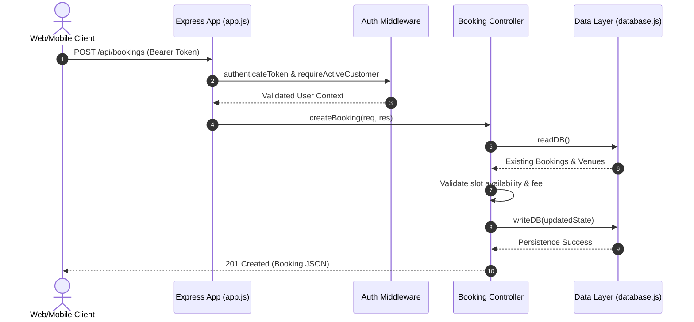

# SportZone: Backend Modular Architecture & Faculty Demonstration Report

## 1. Modular Backend Architecture Overview

The SportZone backend has been refactored from a single `server.js` file into a clean, industry-standard modular layer architecture following the Separation of Concerns (SoC) pattern.

```text
backend/
├── server.js                 # Entry point: Starts the Express server
├── app.js                    # Application config: Middleware & route mounting
├── config/
│   ├── constants.js          # App constants (JWT secret, Port, Time slots, Default DB)
│   └── database.js           # Data persistence layer (MongoDB & JSON seed fallback)
├── utils/
│   ├── helpers.js            # General utilities (JWT signing, ID generator, formatting)
│   └── asyncHandler.js       # Async wrapper for clean error handling
├── middleware/
│   ├── authMiddleware.js     # JWT verification, Admin check, Customer status validation
│   └── errorHandler.js       # Global Express error handler
├── controllers/
│   ├── authController.js     # Handles /api/auth (Register, Login, Admin Login, Profile)
│   ├── bookingController.js  # Handles /api/bookings, /api/slots, tournament requests
│   ├── adminController.js    # Handles /api/admin (Dashboard, User & Venue management)
│   ├── statsController.js    # Handles /api/config & /api/dashboard/stats
│   └── pageController.js     # Serves frontend HTML views
├── routes/
│   ├── authRoutes.js         # Express router for authentication
│   ├── bookingRoutes.js      # Express router for bookings & slot availability
│   ├── adminRoutes.js        # Express router for admin management
│   ├── statsRoutes.js        # Express router for app config & stats
│   └── pageRoutes.js         # Express router for clean & .html view routes
└── tests/
    └── api.test.js           # Automated backend test suite
```

---

## 2. API Endpoints Reference

### Public & Frontend Routes (`pageRoutes.js`)
- `GET /` & `GET /index.html`: Serves Home Page.
- `GET /auth` & `GET /auth.html`: Serves Customer Login/Register Page.
- `GET /dashboard` & `GET /dashboard.html`: Serves Customer Booking App.
- `GET /admin` & `GET /admin-login.html`: Serves Admin Login Page.
- `GET /admin-dashboard` & `GET /admin-dashboard.html`: Serves Admin Dashboard.
- `GET /compare` & `GET /compare.html`: Serves Platform Comparison Page.

### Public API Endpoints (`statsRoutes.js` & `bookingRoutes.js`)
- `GET /api/config`: Returns active venues, time slots, and currency configuration.
- `GET /api/dashboard/stats`: Returns aggregated public statistics.
- `GET /api/bookings`: Returns today's active bookings.
- `GET /api/slots?venue=Name&date=YYYY-MM-DD`: Returns live slot availability.

### Authentication Endpoints (`authRoutes.js`)
- `POST /api/auth/register`: Register customer account (`name`, `phone`, `password`).
- `POST /api/auth/login`: Authenticate customer account using mobile number & password.
- `GET /api/auth/me`: Validates JWT token and returns current user info.

### Protected Customer Endpoints (`bookingRoutes.js`)
- `POST /api/bookings`: Creates slot booking (requires JWT & active account).
- `DELETE /api/bookings/:id`: Cancels customer's own booking (requires JWT).
- `POST /api/tournament-venue-requests`: Submits tournament venue request (requires JWT).

### Admin Endpoints (`adminRoutes.js`)
- `POST /api/admin/login`: Authenticate admin account.
- `GET /api/admin/dashboard`: Returns admin analytics, customer list, bookings, venues.
- `PATCH /api/admin/users/:id/status`: Updates customer status (`Approved`, `Blocked`, `Rejected`).
- `POST /api/admin/venues` & `PATCH /api/admin/venues/:id`: Manages venue catalog.
- `POST /api/admin/tournaments` & `PATCH /api/admin/tournaments/:id`: Manages tournaments.
- `PATCH /api/admin/bookings/:id/status`: Approves or rejects customer bookings.
- `PATCH /api/admin/tournament-venue-requests/:id/status`: Approves or rejects tournament requests.

---

## 3. Data Flow & Communication Architecture



---

## 4. Mobile & Frontend Integration

- **Web Frontend**: Makes standard `fetch()` or `XMLHttpRequest` calls using relative `/api/*` endpoints.
- **Android Mobile App**: Configured with `apiBaseUrl` in Capacitor settings pointing to the host backend address (`http://10.0.2.2:3000` for Android emulator or production server URL). Token authentication works identically across Web and Mobile via JWT HTTP headers.

---

## 5. Persistence Strategy

- **Local Storage (Default)**: Reads/writes state to `database/seed-data/db.json` (or `/tmp/sportzone-db.json` on Vercel).
- **MongoDB (Cloud)**: Automatically connects to `MONGODB_URI` when configured in environment variables, syncing application state under the `sportzone` collection.
- **Normalization**: Standardizes user records, mobile numbers, booking dates, and statuses dynamically upon read.

---

## 6. Commands to Run & Test

### Start Server
```bash
npm run dev
# or
node backend/server.js
```

### Run Backend API Test Suite
```bash
node backend/tests/api.test.js
```
